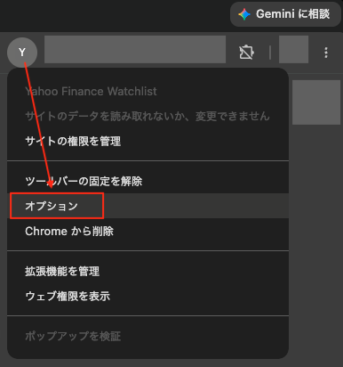
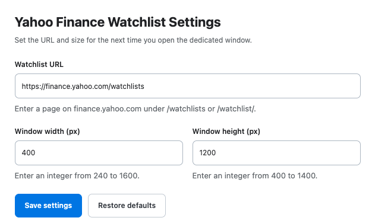
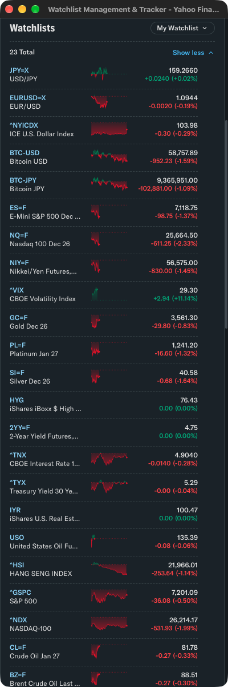

# Yahoo Finance Watchlist

Yahoo Finance の Dock 全体を Chrome の専用ウィンドウに表示する拡張機能です (**Developer mode専用**)。
銘柄検索、Watchlists、Portfolios、Trending tickers などを、縦スクロールで閲覧できます。
既定では [Yahoo Finance の Watchlists 一覧](https://finance.yahoo.com/watchlists) を開き、Dock の準備ができるとウィンドウを幅 400 px、高さ 900 px で表示します。

TradingView向けの機能拡張はこちら → https://github.com/hirotgr/tv-watchlist

## インストールと更新

1. Yahoo Finance にログインしている Chrome プロフィールで `chrome://extensions/` を開きます。
2. **デベロッパー モード**をオンにし、**パッケージ化されていない拡張機能を読み込む**を選びます。
3. `manifest.json` があるプロジェクトフォルダーを指定します。
4. Chrome の拡張機能メニューから **Yahoo Finance Watchlist** をツールバーに固定します。

ファイルを更新した場合は、専用ウィンドウを閉じ、`chrome://extensions/` にある **Yahoo Finance Watchlist** の再読み込みボタンを押します。

## Dock を開く

ツールバーの拡張アイコンをクリックします。
指定のページで Dock が閉じていれば、拡張機能が **Open dock** を押してから専用表示に切り替えます。
起動直後は Dock を展開できるようウィンドウが一時的に広くなります。
アイコンをもう一度押すと、開いている専用ウィンドウに切り替わります。

Dock の縦スクロールバーは 6 px 幅です。
起動後はウィンドウを手動でリサイズできます。

## Options

ツールバーの拡張アイコンを右クリックして **オプション**を選びます。
`chrome://extensions/` で拡張機能の**詳細**を開き、**拡張機能のオプション**を選ぶこともできます。
設定画面の見出しは **Yahoo Finance Watchlist Settings** です。

| 項目 | 既定値 | 入力できる値 |
| --- | --- | --- |
| Watchlist URL | `https://finance.yahoo.com/watchlists` | Yahoo Finance の Watchlists 一覧または個別の Watchlist の HTTPS URL |
| Window width (px) | 400 | 240〜1600 の整数 |
| Window height (px) | 900 | 400〜1400 の整数 |

個別の Watchlist を開くには、Yahoo Finance で対象のリストを開き、アドレスバーから URL をコピーします。
たとえば `https://finance.yahoo.com/watchlist/p_3/view/v1` のような URL を指定できます。

**Save settings** を押し、専用ウィンドウを閉じてから拡張アイコンで開き直すと、新しい URL と初期サイズが反映されます。
**Restore defaults** を押すと、表の値がその場で保存されます。

## Dock が表示されない場合

- Yahoo Finance でログイン状態を確認し、Options に保存した URL を通常のタブで開けるか確かめます。一覧の URL は末尾が複数形の `/watchlists` です。
- 専用ウィンドウに Yahoo Finance の通常画面が残った場合は、対象の Watchlist ページを再読み込みします。起動 URL からやり直すには、専用ウィンドウを閉じて拡張アイコンを押します。

## 権限

| 権限 | 用途 |
| --- | --- |
| `scripting` | 専用タブに JavaScript と CSS を適用する |
| `storage` | Options の設定と専用タブの管理情報を保存する |
| `https://finance.yahoo.com/*` | Yahoo Finance のページにアクセスする |

コードの構成と動作確認の手順は [実装詳細](implementation.md) を参照してください。

## 動作イメージ

Dock全体を切り出しているのでWatchlistを表示する場合はマウスホイールで縦スクロールしてください。

